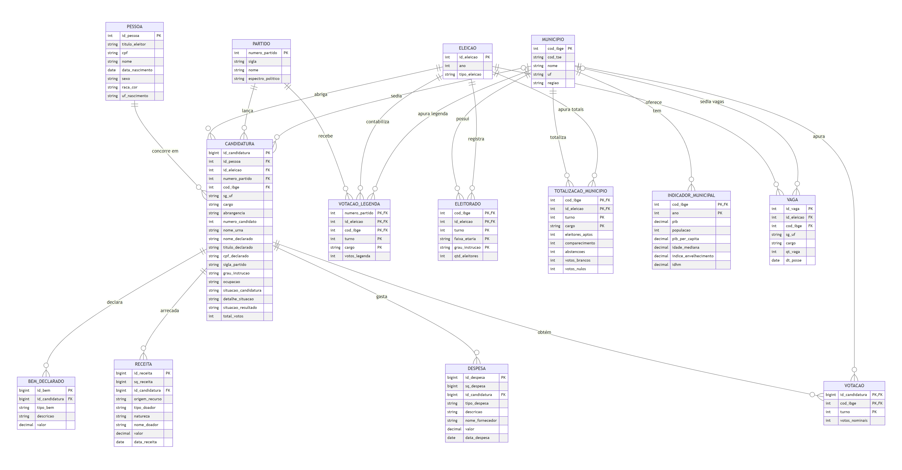
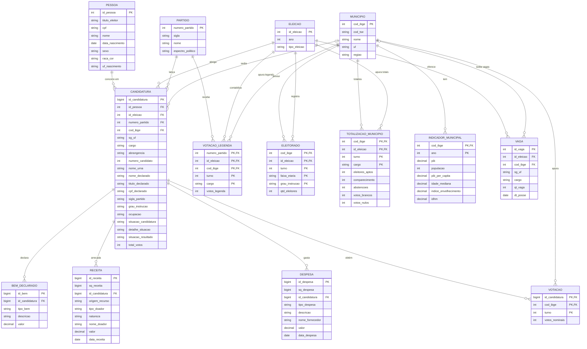

# DER do banco eleicoes_v2

Diagrama entidade-relacionamento da versão 2 do banco, gerado a partir do DDL real (`dados/questoes/carga_v2/der_eleicoes_v2.sql`):
14 entidades. Imagem para o dossiê: [DER_v2.png](DER_v2.png) (ou [DER_v2.svg](DER_v2.svg), que amplia sem perder qualidade).
O código-fonte do diagrama é [DER_v2.mmd](DER_v2.mmd); o bloco abaixo é o mesmo e o GitHub o desenha sozinho.

## O que mudou da v1 para a v2

| Mudança | Por quê |
|---|---|
| `PESSOA` ganhou a chave sintética `id_pessoa`; `titulo_eleitor` e `cpf` viraram atributos comuns | No TSE a mesma pessoa aparece com títulos diferentes e pessoas diferentes com o mesmo título. A identidade é resolvida na carga (CPF, nome + nascimento, título) |
| `CANDIDATURA` guarda `titulo_declarado`, `cpf_declarado` e `nome_declarado` como vieram do TSE, e ganhou `id_pessoa` como chave estrangeira | Preserva o dado original e permite revisar a resolução de identidade |
| `CANDIDATURA` ganhou `numero_candidato`, `nome_urna`, `sigla_partido` (sigla da época), `detalhe_situacao` e `situacao_candidatura` | A sigla muda entre eleições (renomeações e fusões); a situação separa registro deferido de indeferido |
| `PESSOA` ganhou `uf_nascimento` | Dado do cadastro de candidatos, útil para conferir identidade |
| `RECEITA` ganhou `sq_receita` e `natureza` (financeiro ou estimável) | O código do TSE se repete em várias linhas; a natureza separa doação em dinheiro de doação em bens e serviços |
| `DESPESA` ganhou `sq_despesa` | Mesmo motivo da receita |
| `VOTACAO` e `VOTACAO_LEGENDA` carregadas (2018 a 2024, eleições proporcionais) | Já existiam no modelo, mas sem carga; sustentam a Q5 e a parte 2 da Q4 |
| `CANDIDATURA.total_votos` preenchido | Soma dos votos nominais válidos do candidato |
| `TOTALIZACAO_MUNICIPIO`: soma aptos = comparecimento + abstenções tolera diferença de até 10 eleitores | O TSE publica 4 linhas de 2012 (ex.: Aracaju) com diferença de 1 ou 2 |

As entidades `ELEICAO`, `PARTIDO`, `MUNICIPIO`, `ELEITORADO`, `VAGA` e `INDICADOR_MUNICIPAL` seguem como na v1 (a `INDICADOR_MUNICIPAL` agora recebe IDHM, PIB e população de 2010 e a idade mediana de 2022). Todos os relacionamentos são um-para-muitos; `MUNICIPIO`
é opcional em `CANDIDATURA` e `VAGA` (deputados, governador, senador e presidente não pertencem a um município).

## Diagrama (Mermaid)

## Como regerar a imagem

Edite `DER_v2.mmd` e cole o conteúdo em https://mermaid.live para exportar PNG ou SVG. Se mudar o DDL (`der_eleicoes_v2.sql`), atualize também este arquivo.
